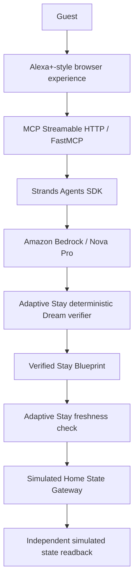

# Adaptive Stay

An MCP-native AI agent that coordinates competing guest needs, verifies the resulting stay configuration, detects stale plans, and independently checks activation.

## Why Adaptive Stay

Individual smart-home automations are easy. Shared stays create coupled constraints: guests can want incompatible temperatures in one climate zone, hot-water capacity is shared, and conditions can change after a plan is generated. Adaptive Stay coordinates the whole stay before applying a configuration.

## What it does

Guest preferences / shared constraints → Dream → Strands + Amazon Bedrock propose configuration → deterministic verification → Verified Stay Blueprint → freshness check → activation → simulated Home State Gateway → independent readback.

**The LLM proposes; it does not verify its own work.** Strands and Bedrock work through the competing guest needs to propose a way forward. Dream verifies that the resulting configuration resolves the shared-resource conflicts before it becomes a Stay Blueprint.

When the stay changes, the old Blueprint is no longer trusted. Adaptive Stay refuses to activate it, re-Dreams the updated situation with Strands and Bedrock, and only proceeds once a new Blueprint is verified.

Once the Blueprint is current, Adaptive Stay applies it through the Home State Gateway. The resulting state is read back independently, and only then is the stay reported as active.

## Demo

[Open the live application](https://ad-eaa7c5234e71450e9b279c154dc91a52.ecs.us-east-1.on.aws).

The browser is a simulated Alexa+-style experience for the hackathon. Guest requests use labeled choices. **Physical device execution and property state are simulated.** The live planner uses Strands and Amazon Bedrock with real model calls. Follow the [judge guide](docs/JUDGE_GUIDE.md).

## Demo scenarios

Open **Experience Lab** to load a scenario:

| Scenario | What to inspect |
|---|---|
| B — One shared climate conflict | Guests want different temperatures in a shared zone. |
| C — Multiple simultaneous shared constraints | Climate and hot-water capacity conflicts must be resolved together. |
| D — Reality changed | An old Blueprint is stale. Activation is blocked until **Dream again** produces a current Blueprint. |
| E — Truly infeasible | Dream fails closed without issuing a Blueprint. |
| C, after verification | **Activate stay**, then **Why can I trust this?** for verification and independent simulated readback. |

The experience presents the resulting configuration and evidence. It does not present a menu of alternative model candidates.

## Architecture



Amazon Bedrock provides inference; AWS ECS Express Gateway hosts the application. MCP is the transport. Dream, Blueprint binding, freshness checks, and activation decisions are Adaptive Stay logic. The gateway operates on simulated property state. See [architecture](docs/ARCHITECTURE.md).

## Built with

- Python 3.12 (the Docker image version).
- Official MCP Python SDK / FastMCP and MCP Streamable HTTP.
- Strands Agents SDK, Amazon Bedrock / Nova Pro, boto3 and botocore.
- AWS ECS Express Gateway for the hosted demo.
- Starlette, uvicorn, httpx, Pydantic, and supporting dependencies pinned in [requirements.txt](requirements.txt).

## Safety / trust model

The model proposes; the deterministic verifier decides whether the proposal resolves constraints. A Blueprint is bound to current stay and shared-resource state. Stale plans fail closed. Activation requires independent simulated readback that matches the configuration. Session isolation keeps visitors' stays separate.

## Running locally

From the repository root, use Python 3.12 and a virtual environment. PowerShell:

```powershell
python -m venv .venv
.\.venv\Scripts\Activate.ps1
python -m pip install -r requirements.txt
$env:COOKIE_SECURE = "false"
$env:PLANNER_KIND = "Fixture"
python app_server.py
```

On macOS/Linux, activate with `source .venv/bin/activate`, then set `export COOKIE_SECURE=false` and `export PLANNER_KIND=Fixture` before starting the same server.

Open [http://127.0.0.1:8080](http://127.0.0.1:8080). Health is at `/health`; MCP is at `/mcp`. `PORT` defaults to `8080`. Disable secure cookies only for local HTTP; use secure cookies for HTTPS hosting.

Fixture mode needs no AWS credentials and exercises deterministic verification, stale-plan protection, and simulated activation. It does not demonstrate model inference.

For real Bedrock planning, `PLANNER_KIND=Live` uses Nova Pro in `us-east-1`, tries the named `agent-factory` AWS profile, and falls back to the default AWS credential chain if that profile is absent. Credentials need STS identity access and Bedrock invocation permissions. **This submission pins an identity allowlist to its development identity and ECS task role. Arbitrary AWS credentials will be rejected.** Use the hosted demo to try live inference; the checked-in local reproduction path is Fixture mode. No credentials are supplied, and this reconciliation does not widen the identity gate.

## Testing

Run these credential-free checks from the repository root:

```powershell
python test_home_state_gateway.py
python test_identity_gate.py
python test_live_planner_profile_fallback.py
```

With the local Fixture server running in another terminal:

```powershell
python verify_container.py http://127.0.0.1:8080
python verify_gate_i_ui.py http://127.0.0.1:8080
python verify_dual_session_and_checkout.py http://127.0.0.1:8080
python verify_no_silent_fallback.py http://127.0.0.1:8080 fixture

```

See [testing](docs/TESTING.md) for results and limits. `verify_container.py` checks a running HTTP service; its name alone does not establish that Docker was built. Live Bedrock verification uses the anti-fallback script with backend `strands`.

## Repository layout

```text
README.md / LICENSE / .gitignore / .dockerignore
app_server.py           HTTP host, visitor sessions, MCP proxy
studio/                 UI, MCP tools, planner, deterministic logic, simulated gateway
requirements.txt        Pinned runtime dependencies
Dockerfile              Production container recipe
test_*.py              Credential-free checks
verify_*.py             HTTP/MCP verification tools
docs/                   Architecture, judge guide, testing, AWS integration, friction
```

Production contents remain at the root to preserve imports and Docker behavior. Historical non-submission code and later provider experiments are outside this submission branch.

## Hackathon

Built for **Build, Ship, Shape: Amazon Developer Hackathon**.

Primary Track: **Alexa+ / MCP**. Mini Challenge: **AWS Builder**.

## License

[MIT License](LICENSE), with the existing copyright notice preserved.
